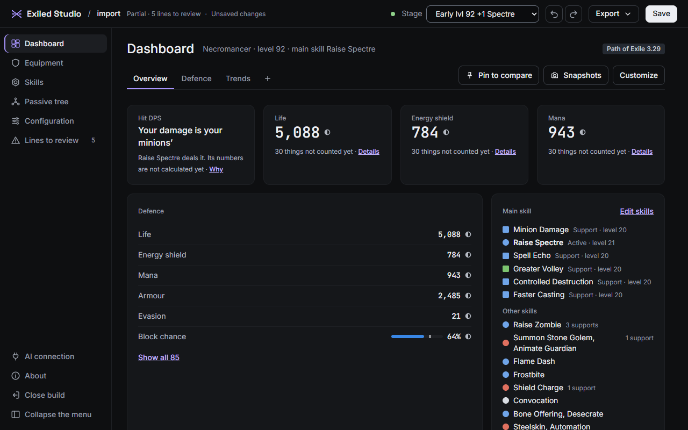
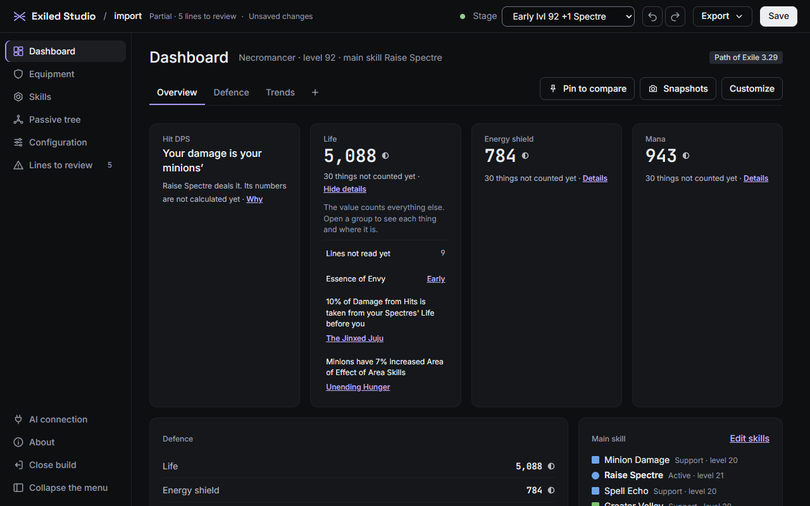
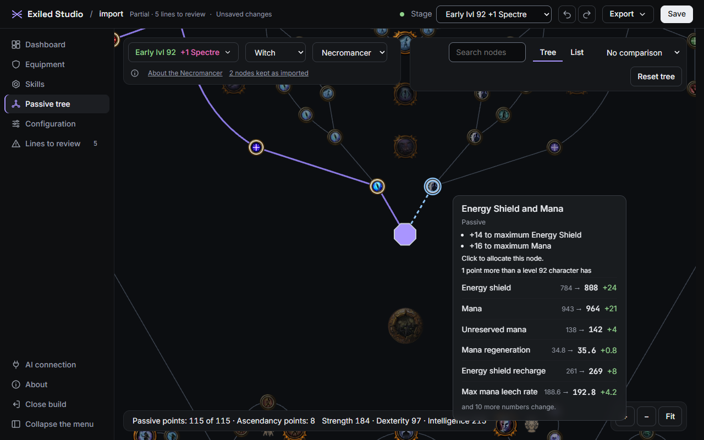

# Second audit pass after the UI revamp (RV-08, 2026-11-25)

The revamp's twelve pull requests (#168 to #179) were each checked alone. This pass checks the whole application after all of them, with the audit list the revamp plan used (the `unslop` skill's signs and checklist), at 1,000, 1,280, and 1,600 px. It is task RV-08 of `dev/active/ux-improvements/ui-revamp-follow-ups.md`.

**Result:** the revamp holds. No sign from the list's colour, type, icon, or motion groups is left. The pass found seven defects, fixed here, and twelve things that change how a screen looks, added as tasks RV-27 to RV-38 (each needs the maintainer's eye first, as the follow-ups file says).

## How it was run
- The real application (`loom-tauri` with the `e2e` feature, built from `dev` at `ec2e68e0`), driven over WebView2's debugging port, with the real game data bundle (Path of Exile 3.29, build 26530219) and the Raise Spectre community fixture (`tools/oracle/fixtures/community/forged-frostbearer-spectre-necromancer.xml`: 18 stages, 136 items).
- Nine screens (the import review, Dashboard, Equipment, Skills, Passive tree, Configuration, Lines to review, AI connection, About) at the three widths, 800 px high: a screenshot and a measurement of every visible element each (27 captures). Then the secondary views at 1,280 px: the Defence and Trends dashboards, Customize, a card's Details, Snapshots, the Skills table, the gem picker, the tree's list and hover card, the item editor, the collapsed menu, the start page with a recent build.
- Screenshots of what was fixed and of the larger open items are in `ux-audit-pass-2/`. None shows the passive tree's art.

## What was measured, and is clean
On all 27 captures:

| Sign | Measured |
|---|---|
| Sideways scroll | none at any width |
| Uppercase text, letter spacing, italics | none |
| Gradients, glows, coloured shadows | none (the one shadow is the active menu item's 2 px inset mark) |
| Emoji, exclamation marks in the interface's own text | none (the one "!" is in a stage name the build's author wrote) |
| `transition: all`, looping animation | none |
| Text sizes | 12, 14, 16, 24, 28 px only; nothing under 11 px |
| Weights | 400 and 500; 600 once or twice a screen; 700 once (the main skill's name on the Dashboard, a `strong`) |
| Corners | 2, 4, 8, 12 px and circles |
| Faces | Inter, JetBrains Mono for figures, Space Grotesk for the product name |
| Spacing off the 4 px grid | only margins set in `em` in the equipment panel (3.5 and 10.5 px) and the browser's own radio margins on About |
| Keyboard focus | a 2 px ring on every control tried |

## Fixed in this pull request

| # | Found | Fix | Checked in the running application |
|---|---|---|---|
| 1 | **Configuration had two scrollbars and moved the header.** The window itself scrolled (889 px in an 800 px window), so the header sat 15 px to the left of where it is on every other page. Text kept for screen readers inside the long list was placed outside the frame. | The frame is the containing block for such text (`.app { position: relative }`), so it is clipped there. | The document is 800 of 800 px on all eight pages at all three widths. `before-config.png`, `after-config.png` |
| 2 | **The import review's numbers disagreed:** the sentence said "35 lines … 30 of them on items not in use", the card and the list said 5 and 25. The sentence counted each item a line is on, the card counted rows. | Every count on the page is in rows. | "30 lines … 25 of them", the card "5 … and 25 more". |
| 3 | **The Skills table printed colour codes** ("^5==== Main Skills", "6L ^25-Frostbearers"). The Groups view drew them. | The table draws them the same way; names read aloud use the plain text. | No "^" on the page. `before-skills-table.png`, `after-skills-table.png` |
| 4 | **Gem names in the Skills table were in the figure face.** A data table's cells take it; these cells hold words. | The text face for the names, the figure face for the levels. | Inter for names, JetBrains Mono for levels. |
| 5 | **A chart's stage names ran into each other** (Progression by stage: 18 names of about 20 characters under a 280 px plot). The spacing assumed 56 px a label. | Each label's room is measured from its own text; the ends first, then the current point, then whatever fits. Every point is still named by the readout (pointer or arrow keys). | 0 overlapping labels at 1,000, 1,280, and 1,600 px. `before-trends.png`, `after-trends.png`. Test: `ui/src/test/chart-labels.test.tsx`. |
| 6 | **The collapsed menu cut a name:** "Lines to revi…" (the page was renamed after step 1 checked the rail). | A long name takes a second line. | No name cut. `after-rail.png` |
| 7 | **Small:** the font licence texts on About were in the browser's default monospace; "1 support" broke over two lines beside a long skill name on the Dashboard. | The mono face; the count does not wrap. | Seen at 1,280 px. |

## Open: added as tasks
Each changes how a screen looks, so each is a task with a mockup or the maintainer's word first. The IDs are in `ui-revamp-follow-ups.md`, "From the second audit pass".

| Task | Where | What |
|---|---|---|
| RV-27 | Skills, under 1,000 px | One column: the 18 groups fill the page and the picked group's gems are below them all, so picking a group changes nothing on screen. `open-skills-1000.png` |
| RV-28 | Dashboard, at 1,000 px | The four lead figures are one a row, each mostly empty. The breakpoints measure the window, not the page, and the menu takes 208 px of it. `open-dashboard-1000.png` |
| RV-29 | Every card with a table | The card's heading is 40 px from its edge (import review, Lines to review, Equipment's "In use", Recent); other cards' are 20 px. |
| RV-30 | Equipment, at 1,280 px | Item names break over two lines ("Early Trigger wand") while the Sockets column has room to spare. |
| RV-31 | Passive tree | Three "i" marks in a row with nothing beside them; they are "More information", "About the Necromancer", and "Allocated nodes kept as imported: 2". The class start's hover card says "WITCH" in capitals. |
| RV-32 | Passive tree, List | Rows without a card, and a "Remove (the passive's whole name)" button of a different width on every row. `open-tree-list.png` |
| RV-33 | Controls | About's radio buttons are the browser's own (system blue) beside the application's checkboxes; selects and inputs are 32 px in some places and 36 px in others; the focus ring is blue and the accent is violet. |
| RV-34 | Accent | "The accent violet used rarely": Lines to review shows 30 violet, underlined, medium-weight item names, and each start page and About card ends in a violet link beside its buttons. |
| RV-35 | Skills table | An author's divider ("==== Main Skills ====") is a row with "No gems yet" and "None"; the Groups view has headings. |
| RV-36 | Lines to review | The folded "25 lines on items not in use" has no mark that it opens; the same fold on the import review has a triangle. |
| RV-37 | Gem picker | The list starts with a gem named "…" (Attack, Melee, Strike): find it in the data, then name it or leave it out. Not a look question: no mockup. |
| RV-38 | Small text and overflow | The Snapshots name field's hint is cut ("Name, such as"); a Configuration input's description ends in an ellipsis at 1,280 px; short empty-state lines end in a period ("No recent builds.", "No change requests.", "Nothing to chart yet."); on Trends, the Compare card's sentence touches its button; the main skill's name on the Dashboard is weight 700. |

Added to tasks that were already open:
- **RV-07** (the item editor): its head is broken at 1,280 px. The name is squeezed into three lines beside an empty row, and "Back to equipment" floats in the middle. `open-item-editor.png`
- **RV-06** (the remaining pills): the AI connection page has four (Stopped, Allowed, Off, Ask each time); the Skills page's "Main skill group" pill is blue, a second accent beside the violet.
- **RV-03** (a card under another): at 1,600 px the Defence card's rows stretch about 850 px between a name and its value, and the card has a dead band under "Show all 85" beside the taller Main skill card.

## Done later on the same pull request
At the maintainer's word (2026-11-25, "continue with the open items"; the bundling rule, ADR-012 Amendment 1), these of the tasks above were done on PR #183, each checked in the running application at 1,280 px:

| Task | Done |
|---|---|
| RV-29 | A card's heading and its table's first column are 20 px from the edge on the import review, Lines to review, and Equipment (measured 21 px with the border on each). The revamp's panel rule had added a second 20 px to a table card; the review list and the equipment rows had 16 px. |
| RV-30 | The slot and note columns are narrower; "Early Trigger wand", "Low budget Helmet", and "Darkness Enthroned" are one line. Long flask names still take two. |
| RV-36 | The fold has a triangle that turns down when open. |
| RV-37 | The gem is `SkillGemComboStrike`, which the game itself names "...": an unreleased gem. Left out of the picker, as `[DNT]` names are. |
| RV-38 | The hint is "Name"; short empty-state lines have no period; the Compare card has its gap; the main skill's name is weight 600. **Escape and the Snapshots panel, settled:** opening the panel put the focus on its help mark, whose text opened over the form and took the first Escape. The focus now goes to the name field, and one Escape closes the panel. Left: the Configuration description that ends in an ellipsis. |

Also on the PR, from the list's older tasks: RV-05 (Discard all), RV-02 (bars against the cap of 75 for block, spell block, and the resistances in the Defence table, one column), RV-13 (see `docs/release/channels.md`, "Going back to an older version").

## Built from the approved mockups
The maintainer approved eight boards on 2026-11-25; each is built on PR #183 and was checked in the running application on the same fixture.

| Task | Built | Checked |
|---|---|---|
| RV-01 | "Reset to default" in Customize, for a changed Overview, Defence, or Trends; asks first | Not offered before a change; the test `rv-mockups.test.tsx` removes a card and resets |
| RV-27 | Skills under 1,000 px: one picker with previous and next over the group | At 1,000 px the picker shows and the list is hidden, the group's card starts at 221 px; Next goes to the Helmet's group; at 1,280 px the list is back |
| RV-28 | Dashboard: two lead figures a row down to 760 px | Two a row at 1,000 and 800 px, one at 700 px; no overflow |
| RV-31 | The tree's notes as words; "Witch" | "About the Necromancer", "2 nodes kept as imported"; the class start's card reads "Witch" |
| RV-32 | The tree's list in a card, tabs, one short action a row | "Remove" 53 px on every row; no overflow at 1,000 and 1,600 px |
| RV-33 | The application's own radio buttons; 36 px selects and fields | The radio is 16 px in the accent; Configuration's selects and fields all 36 px |
| RV-34 | Quiet links in tables and beside buttons | Item names on Lines to review in the text's colour |
| RV-35 | An author's divider as a heading in the Skills table | "Main Skills", "Utility", "Auras" are headings |
| RV-06, RV-07 | The item editor's head and line states; the AI connection page's states | The name is one line (30 px); no overflow at 1,000 and 1,600 px |

Not as the mockup: the dashboard reset is not taken back by Undo when the dashboards are kept for every build (they are preferences, outside the build's history); the Dashboard follows the window's width, not the page's own (a container would have caught the item tooltip); the tree keeps one "i" for the page's help.

## The rest of the list (2026-11-25)
The maintainer: every follow-up but RV-10 in one go. Checked in the rebuilt application at 1,280 px on the same fixture.

| Task | What was built | Seen |
|---|---|---|
| RV-03 | A card can be two rows tall; the default Overview has the Defence table tall, the main skill over the lines to review beside it. |  The Defence card is 662 by 968 px; the two cards beside it are 323 px wide, 461 and 491 px tall. |
| RV-22 | A card's Details open in the card. |  No dialog. A quarter-width card is narrow for it, and its row grows to the list's height (at most 16 rem). |
| RV-20, RV-04 | The tree by keys, and the points left. |  Home, then the arrows along the links; End is the Necromancer's start; the card of a node not taken says "1 point more than a level 92 character has" (115 of 115 spent). |
| RV-38 | A long Configuration description has "More". | One on the fixture's page. |

Built without a new mockup at the maintainer's word: RV-20 and RV-22. Panning the tree from Fit for five seconds on this workstation: no frame over 16.6 ms.

## Not covered
- The Export menu (its capture failed), the breakdown page, the paste form, an item's hover tooltip, the start page with recovery copies. Whether Escape closes the Snapshots panel was not settled.
- The header at 1,000 px is two rows with Export and Save alone on the second; step 2 accepted that.
- A screen reader (RV-18) and the tree's frame rate (RV-09) are their own tasks.
- macOS and Linux: this ran on Windows (WebView2) only.
